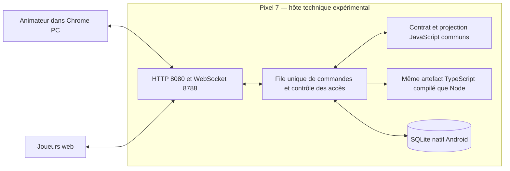

# P16 — Trois questions, client Pixel et hôte Android

**22 novembre 2026.** Cette étape prolonge [P15](P15_MAQUETTE_JOUABLE.md), qui reste le relevé historique de la première question sur PC.

## Parcours disponible

Une salle d'attente, trois QCM isolés de 30 secondes, réponse définitive, pause/reprise, correction manuelle après chaque question, bouton **Question suivante**, classement cumulé puis classement final. Chaque bonne réponse rapporte 1 000 points fixes ; maximum : 3 000 points. Ce parcours ne modélise pas encore les manches aux scores masqués.

| Étape de la feuille de route | Résultat observé |
|---|---|
| 3 — Trois questions et cumul | Positif : tests du moteur, WebSocket et Chrome PC. |
| 4 — Pixel joueur, hôte Node sur PC | Positif : Chrome du Pixel, HTTPS/WSS local, trois réponses et 3 000 points. |
| 5 — Même parcours hébergé sur Android | Positif sur Wi-Fi habituel puis point d'accès : serveur HTTP/WebSocket natif, même moteur, SQLite et interfaces web PC. |
| 5 — Partie complète sans Internet | Positif : accès amont du Pixel coupés par l'utilisateur, Ethernet PC désactivé, trois questions et classement depuis le Pixel. |

## Architecture effectivement assemblée



L'application Android héberge ; l'identité animateur vient de la création de salle dans le navigateur. Le propriétaire du téléphone ne reçoit aucun droit d'animation du fait de l'hébergement. Un joueur ne peut pas lancer la partie.

Le moteur expose désormais `createQuiz`, `applyQuiz`, `recoverQuiz` et `quizRanking`, tout en conservant les fonctions d'une question utilisées par les expériences précédentes. La progression après correction et le cumul sont calculés par cet artefact commun ; aucune réécriture du score ou de la progression en Java.

Le contrat des messages, la traduction des commandes et le filtrage des résultats sont aussi partagés. Les adaptateurs gardent horloge monotone, jetons, HTTP/WebSocket, transactions et cycle de vie. Le moteur conserve zéro dépendance d'exécution externe et les contrôles automatiques d'imports/API/transitivité.

Empreinte du moteur testé sur Node et chargé par l'hôte Android :

```text
672ba13691f39a3411f540f21e92b975d9e8ac084cd04ac7c8db62e7c5a5d11e
```

Le journal de l'hôte Android confirme cette empreinte après vérification du manifeste. Le parcours réseau vérifie les mêmes résultats attendus sur les deux hôtes ; il ne constitue pas une comparaison exhaustive de tous leurs états internes.

## Fichiers et dépendances

| Responsabilité | Emplacement |
|---|---|
| Règles et cumul | `packages/engine/src/engine.ts` |
| Contrat d'entrée partagé | `packages/protocol/mock.mjs` |
| Commandes, admission et projection partagées | `packages/protocol/mock-presentation.js` |
| Adaptateur Node et salles | `apps/server-node/mock-server.mjs`, `mock-rooms.mjs` |
| Transactions des quiz sur Node | `apps/server-node/persistence/sqlite-quiz-store.mjs` |
| Interfaces communes | `apps/web/mock/` |
| Pont moteur Android | `EngineBridge.java` dans l'application expérimentale |
| Adaptateur Android sérialisé et stockage natif | `QuizHost.java` |
| Cycle de vie et notification Android | `QuizService.java` |
| Préparation vérifiée des ressources communes | `tooling/prepare-mock-assets.mjs` |
| Tests réseau et 30 joueurs simulés sur Node | `tests/integration/mock-server.test.mjs` |
| Recette navigateur, Pixel et reprise réelle | `tooling/test-mock-browser.mjs`, `test-pixel-player.mjs`, `test-android-quiz-recovery.mjs` |

Les dépendances du moteur ne changent pas. L'adaptateur Android réutilise AndroidX JavaScriptEngine 1.1.1, Java-WebSocket 1.6.0 et SQLite système ; il ajoute **NanoHTTPD 2.3.1** pour servir les fichiers web et l'API HTTP. Cette petite bibliothèque reste un choix d'expérience, hors moteur, sans sélection définitive d'une pile serveur Android. Voir le [projet amont](https://github.com/NanoHttpd/nanohttpd/tree/nanohttpd-project-2.3.1/core).

L'APK embarque directement les mêmes fichiers web. Le contrat d'entrée est préparé en script autonome en retirant uniquement le mot-clé d'export ; les règles moteur ne sont pas transformées pour Android. Gradle contrôle l'empreinte moteur ainsi que les empreintes des sources et ressources de la maquette : une préparation périmée refuse la compilation.

## Persistance et messages retardés

- Chaque réponse et chaque commande relative à une question portent son identifiant. Un message d'une question précédente ne peut ni répondre ni faire progresser la suivante.
- Le registre SQLite impose l'unicité par session, question et soumission, ainsi qu'une réponse par joueur et question. Le même identifiant de soumission peut être réutilisé dans une autre question sans collision.
- État du quiz et réponse sont écrits dans une même transaction. Une confirmation sort seulement après commit. Le client n'affiche ni score ni correction avant révélation.
- Le passage à la question suivante est lui aussi transactionnel ; un échec SQL conserve la question et les points précédents.
- Une reprise fige uniquement la question courante encore active au dernier état sauvegardé. Les questions achevées et leurs réponses restent conservées ; correction et fin de quiz ne se rouvrent pas.
- Le classement est recalculé à partir des états conservés, sans ajout répétitif de points lors des diffusions ou reconnexions.

Les bases historiques sont conservées. La maquette utilise désormais `.tools/mock/quiz-v2.sqlite` sur PC et `kuikuiz-playable-v2.db` dans les données privées Android. Les anciens diagnostics SQLite gardent leur propre base. Pas de migration automatique entre empreintes de moteur.

## Reproduire sur PC et Pixel joueur

```powershell
npm.cmd run dev:mock
```

Ouvrir `http://localhost:4180`, créer la salle animateur et rejoindre dans un autre profil navigateur. Après chaque correction, cliquer sur **Question suivante**.

Pour le Pixel sur le même Wi-Fi, avec les certificats de laboratoire **déjà préparés** :

```powershell
npm.cmd run dev:mock -- --https
```

Le serveur écoute alors sur le réseau local, port 4180. Lors de l'essai : `https://192.168.1.23:4180/joueur`. Cette adresse doit correspondre au certificat. Aucun certificat ni magasin de confiance n'est modifié par cette commande.

La recette Pixel utilise le débogage navigateur autorisé avec une redirection ADB vers `chrome_devtools_remote`, puis `npm.cmd run test:mock:pixel`. L'exception TLS du script est limitée au contexte Chrome de test **sur PC** ; le script ne désactive aucune vérification TLS du Chrome du Pixel. Ce dernier disposait déjà de l'autorité de laboratoire approuvée pendant les expériences précédentes. Ce n'est pas le parcours de confiance final du produit.

## Reproduire avec Android hôte

1. Préparer les ressources depuis la racine : `npm.cmd run prepare:mock-android`.
2. Compiler l'application avec JDK 17, SDK Android 35 et Gradle 8.11.1 ; voir le README Android et `tooling/build-android-probe.ps1`. Si la politique PowerShell locale interdit ce script, invoquer directement `gradle.bat` avec les variables d'environnement de la session ; ne pas modifier la politique.
3. Installer l'APK avec `adb install -r`, ouvrir l'application et toucher **Héberger la maquette de quiz**. La notification correspond au service hôte.
4. Ouvrir `http://ADRESSE_DU_PIXEL:8080/animateur` sur le PC personnel, puis `/joueur` dans un autre profil. Les fichiers, commandes et scores proviennent du Pixel. Aucun serveur PC n'est requis.

Adresses constatées : `192.168.1.21` sur le Wi-Fi habituel et `10.186.21.94` sur le point d'accès. Elles ne sont pas garanties permanentes ; relever la passerelle du PC ou les adresses affichées dans l'application.

```powershell
$env:KUIKUIZ_ORIGIN='http://ADRESSE_DU_PIXEL:8080'
npm.cmd run test:mock:live
npm.cmd run test:mock:browser
```

`test:mock:android-recovery` nécessite en plus `KUIKUIZ_ADB` et `KUIKUIZ_DEVICE` explicites. Il force l'arrêt de **la seule application expérimentale `fr.kuikuiz.probe`**, la relance depuis son écran, retrouve la partie et termine le quiz. Ne pas le lancer pendant une partie que l'on souhaite garder active.

Pour l'essai sans Internet : PC uniquement sur le point d'accès, Ethernet débranché ; données mobiles **et Wi-Fi amont du Pixel coupés**, point d'accès toujours actif. Le Pixel observé peut conserver une connexion au Wi-Fi habituel tout en hébergeant son point d'accès : couper seulement les données mobiles ne suffit pas. Charger à nouveau les pages depuis le Pixel, puis jouer les trois questions.

Si la coupure interrompt aussi l'accès de l'agent à Internet, lancer auparavant `node tooling/test-offline-quiz.mjs`. Le script autonome attend pendant dix minutes maximum qu'Ethernet ne soit plus actif et que deux destinations TCP publiques deviennent injoignables. Il découvre la passerelle Wi-Fi, exécute les recettes réseau et navigateur, recontrôle l'isolement puis écrit `artifacts/mock-preview/offline-quiz-report.json`. Il ne désactive ni ne réactive aucune interface. Attendre environ une minute avant de rétablir l'Ethernet et consulter ce rapport. L'état amont du téléphone doit être confirmé séparément ; les destinations publiques seules ne suffisent pas.

## Essais exécutés et limites

La suite locale termine avec **31 tests Node positifs**, un test TLS positif séparé et les parcours navigateur décrits ci-dessous. Les contrôles du moteur continuent à refuser imports et dépendances d'exécution externes. Les tests réseau couvrent aussi un échec SQL lors de la progression et le refus de commandes retardées.

Au 22 novembre : parcours Chrome PC positif sur Node et sur Android, Pixel physique joueur positif sur Node HTTPS/WSS, protocole Android positif sur les deux réseaux. Rapport synthétique : [P16_PIXEL7.json](results/P16_PIXEL7.json). Les captures et rapports détaillés restent dans `artifacts/mock-preview/`, exclus de Git.

Un arrêt forcé Android a été effectué après confirmation réseau de la réponse à la deuxième question. PID avant : 15389 ; après : 16967. Les navigateurs retrouvent la deuxième question en pause, sa réponse et les points de la première. La partie se termine à 3 000 points. C'est un arrêt **après commit**, pas une coupure matérielle ni une interruption au milieu d'une écriture.

L'essai final hors Internet est **positif** : le rapport autonome relève Ethernet `Disabled`, la seule passerelle Wi-Fi `10.186.21.94`, et deux destinations publiques injoignables avant et après. L'utilisateur a confirmé la coupure des données mobiles et du Wi-Fi amont du Pixel. Le parcours réseau atteint 3 000 points, confirme les retransmissions sans doublon et retrouve la réponse après reconnexion. Le parcours Chrome ouvre de nouveaux contextes, recharge une page, joue trois questions avec deux joueurs et ne demande aucune ressource HTTP hors de l'origine du Pixel.

Sur ce dernier essai, les trois confirmations réseau mesurées valent environ 47, 35 et 95 ms. Trois échantillons ne définissent aucun objectif de latence. Le test après arrêt forcé reste celui sur le Wi-Fi habituel ; sa répétition sur le point d'accès a été interrompue avant arrêt de l'application, car ADB était devenu indisponible. Le jeu a continué sans ce lien de développement.

L'essai Node à 30 joueurs simulés confirme 90 réponses sur trois questions sans doublon. Un relevé sur le PC donne environ 757 ms de médiane, 891 ms de p95 et 895 ms au maximum pour les confirmations du scénario simultané. Ces mesures incluent SQLite et les diffusions ; elles varient selon la machine et ne fixent aucun seuil. Elles ne mesurent ni 30 téléphones physiques ni la capacité du point d'accès Android.

Le jeu Android utilise ici **HTTP et ws**, sur réseau local de confiance. Il ne valide pas WSS Android, une PWA HTTPS vers cet hôte, le cache/service worker de la maquette ou Safari/Firefox. Le test Pixel client de Node valide un autre montage, HTTPS/WSS sur le PC, et ne clôt pas ces inconnues. La sonde PWA et ses preuves historiques restent distinctes.

Le service au premier plan et les commandes sérialisées rendent ce premier assemblage utilisable ; endurance, veille prolongée, batterie, surcharge et abandon du runtime restent à éprouver. Le stockage Node synchrone et les multiples passages par le pont JavaScript Android peuvent limiter la capacité : mesurer avant optimisation. Pas d'éditeur, médias, équipes, rapport final hors ligne, iOS hôte ou relais de projection dans cette étape. Aucun déploiement Internet.
