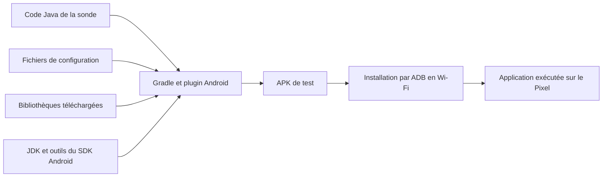

# Comprendre Gradle dans Kuikuiz

Gradle est l'outil qui organise la fabrication de notre application Android : il lit la configuration, récupère les bibliothèques requises et lance les étapes nécessaires pour produire un fichier installable. C'est un outil utilisé sur le PC de développement. [Présentation officielle](https://docs.gradle.org/current/userguide/gradle_basics.html).

## Du code au téléphone



On peut voir Gradle comme le chef d'atelier : il coordonne les outils qui transforment les sources en application. Le **plugin Android pour Gradle**, abrégé **AGP**, lui apporte les tâches propres à Android. Le JDK fournit les outils Java ; le SDK fournit les outils et références Android. [Configuration officielle des builds Android](https://developer.android.com/build).

L'**APK** est le paquet installable produit. **ADB** est l'outil qui communique avec le téléphone pour installer ce paquet, ouvrir l'application et consulter des informations de diagnostic. Une fois installée, la sonde s'exécute sur le téléphone sans Gradle sur le PC.

## Les fichiers que tu vois dans le dépôt

| Fichier | Rôle |
|---|---|
| `experiments/android-local-pwa/android/settings.gradle` | Déclare le projet, son module `app` et les dépôts de bibliothèques. |
| `experiments/android-local-pwa/android/build.gradle` | Fixe la version du plugin Android : actuellement 8.9.2. |
| `experiments/android-local-pwa/android/app/build.gradle` | Définit l'application, ses versions Android cibles et ses dépendances. |
| `experiments/android-local-pwa/android/gradle.properties` | Règle notamment la mémoire disponible pour la compilation. |
| `tooling/build-android-probe.ps1` | Sélectionne les outils locaux et lance la fabrication de l'APK. |
| `.tools/` | Contient les outils et caches téléchargés sur ce PC ; exclu de Git. |

Les fichiers `.gradle` actuels utilisent le langage de configuration Groovy. Cela ne signifie pas que notre application est écrite en Groovy : la sonde Android est en Java et le moteur prévu sera en TypeScript.

## Que fait notre commande ?

Depuis la racine du dépôt :

```powershell
powershell -File tooling/build-android-probe.ps1
```

Le script lance la tâche `assembleDebug`. Gradle et AGP organisent la compilation, le traitement des ressources et la fabrication d'un APK signé pour les essais. Le fichier produit est :

```text
experiments/android-local-pwa/android/app/build/outputs/apk/debug/app-debug.apk
```

Cette commande ne publie pas l'application, ne l'installe pas automatiquement sur le téléphone et ne prouve pas que ses fonctions marchent. L'installation et les essais sont des étapes distinctes. Une compilation `debug` sert au développement ; la publication nécessitera une préparation séparée. [Documentation Android sur la construction](https://developer.android.com/build/build-for-release).

Le premier lancement prend plus de temps parce que les outils téléchargent leurs dépendances et remplissent leurs caches. Les lancements suivants peuvent réutiliser ce travail. Cela ne veut pas dire que la partie de quiz aura besoin d'Internet : la construction sur PC et l'exécution sur téléphone sont deux sujets différents.

## Ce qui est déjà prouvé

Nous avons compilé et installé la sonde, puis reçu un pong depuis le Pixel. Cela prouve ce petit parcours de construction et de transport local. Le moteur TypeScript, WSS, la durabilité et l'arrière-plan restent à démontrer. Voir [les schémas d'architecture](SCHEMAS_ARCHITECTURE.md) et [le compte rendu P7](experiments/P7_WEBSOCKET_PIXEL.md).
