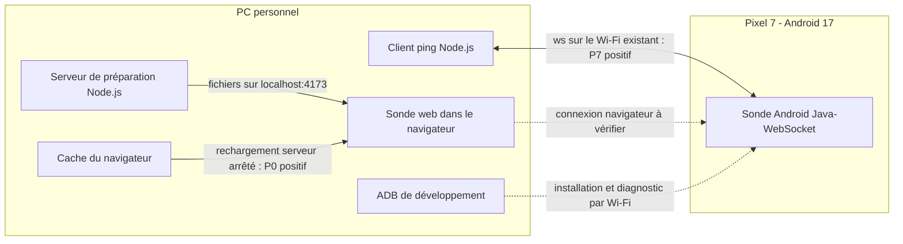
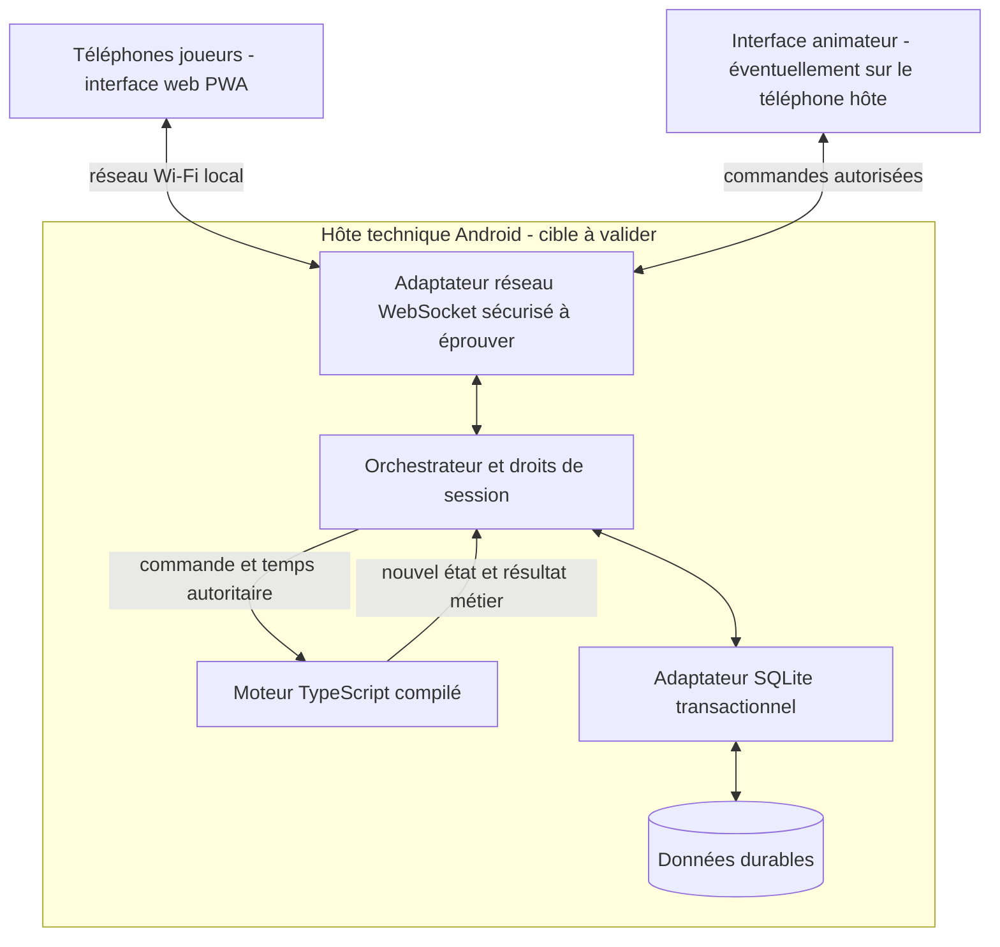
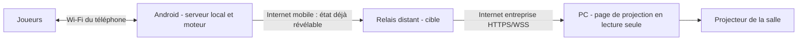
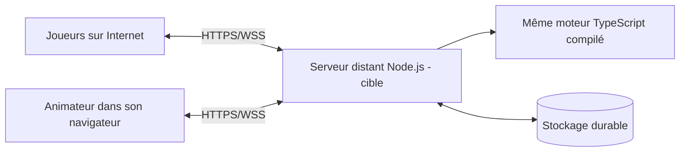
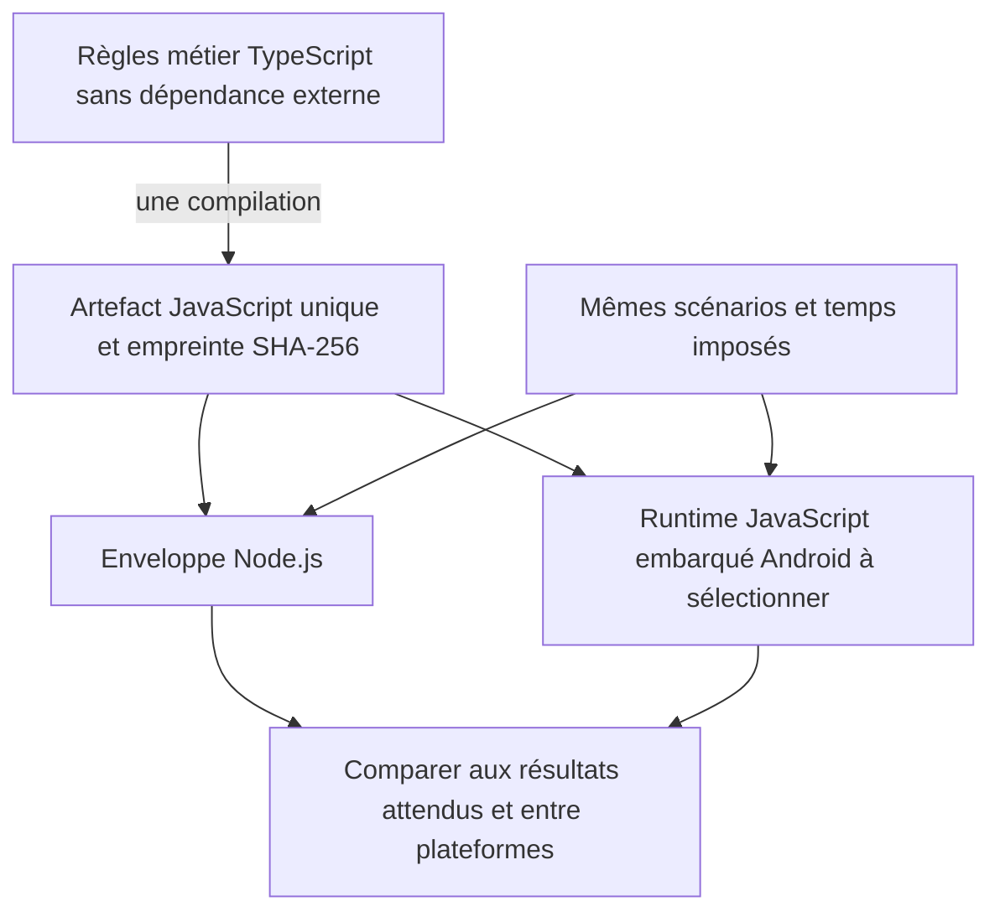

# Kuikuiz — Comprendre l'architecture actuelle et cible

**État de référence :** premier échange WebSocket Node.js PC ↔ Pixel réussi. Ces schémas expliquent l'organisation ; les choix techniques encore ouverts sont détaillés dans [l'architecture](../ARCHITECTURE.md).

Les blocs marqués « cible » ne sont pas encore implémentés. Les schémas Mermaid peuvent être lus dans un aperçu Markdown compatible ; les paragraphes en donnent aussi la lecture.

## 1. Aujourd'hui : une sonde réseau, pas encore un quiz

Le serveur sur PC fournit les fichiers de la page de diagnostic. Il n'héberge aucune partie. Le serveur sur le Pixel répond seulement aux messages ping. Un client Node.js sur PC a confirmé le retour pong ; la connexion depuis le navigateur reste à consigner séparément.

Le PC et le téléphone utilisent pour cet essai le réseau local existant. Le Pixel n'est pas encore testé en point d'accès. Le lien ADB est un outil de développement : les joueurs n'en auront pas besoin.

P0 valide le rechargement de la page après arrêt du serveur selon le retour manuel ; P7 valide un échange WebSocket sans chiffrement au premier plan. Aucun des deux ne démontre encore une PWA HTTPS sur téléphone en réseau sans Internet.

## 2. Cible locale : Android héberge la partie

Les joueurs communiquent avec l'hôte sur le réseau local : point d'accès Android ou routeur externe. Le téléphone calcule les résultats ; les connexions mobiles individuelles des joueurs ne sont pas nécessaires au traitement des réponses.

L'orchestrateur reçoit les commandes, contrôle les droits et demande au moteur d'appliquer les règles. Il sauvegarde le résultat, puis confirme au joueur **après la transaction réussie**. Une retransmission ne doit pas produire de points supplémentaires.

L'animateur pilote ; l'hôte exécute. Ces rôles peuvent être sur le même appareil ou sur deux appareils distincts. Héberger sur le téléphone d'un joueur ne lui donne aucun droit d'animation.

Le runtime Android du moteur, la connexion sécurisée depuis la PWA, la persistance après panne et le maintien en arrière-plan restent à tester.

## 3. Cible en salle : projection depuis un PC d'entreprise

Le PC reste sur le réseau d'entreprise. Il n'a pas besoin de joindre directement le téléphone : le relais reçoit les résultats autorisés et les transmet à la page de projection. Le téléphone reste l'autorité du jeu ; le relais ne corrige pas les réponses et ne calcule pas les scores.

Si Internet ou le relais tombe, la projection devient non actualisée et le signale ; la partie locale continue. Après reconnexion, l'écran récupère le dernier état autorisé. Les résultats encore masqués ne sont pas envoyés prématurément.

La page de projection ne pilote pas la partie. Aucun relais n'est déployé à ce stade. L'accès entreprise et le fonctionnement simultané point d'accès, serveur et connexion mobile sont encore à vérifier.

## 4. Cible Internet : le serveur Node.js héberge la partie

Ici, le serveur distant est l'hôte de la partie, et pas seulement un relais de projection. Son hébergement reste à choisir ; aucun déploiement n'est autorisé implicitement par ce schéma.

## 5. Pourquoi partager le moteur ?

Les règles de score, de pause et de réponse définitive sont écrites une seule fois. Les API réseau, stockage et Android restent dans des adaptateurs. Gradle fabriquera l'enveloppe Android ; il ne remplace pas le moteur TypeScript et ne prouve pas sa portabilité.

La preuve attendue utilise exactement les mêmes octets compilés sur les deux plateformes. Cette expérience reste à réaliser ; la sonde Java actuelle ne contient pas ce moteur.

## Repères

| Mot | Dans Kuikuiz |
|---|---|
| Hôte | Appareil qui exécute la partie et décide de l'acceptation des réponses. |
| Animateur | Personne autorisée à piloter la session. |
| PWA | Interface web préparée pour pouvoir démarrer hors ligne, sous réserve des essais. |
| WebSocket | Connexion permettant des messages dans les deux sens. `wss` ajoute TLS au transport. |
| Adaptateur | Couche reliant les règles communes à un environnement particulier. |
| Relais | Composant qui transmet l'état de projection entre les deux réseaux. |
| Gradle | Outil de construction Android sur le PC ; voir [l'explication](COMPRENDRE_GRADLE.md). |
