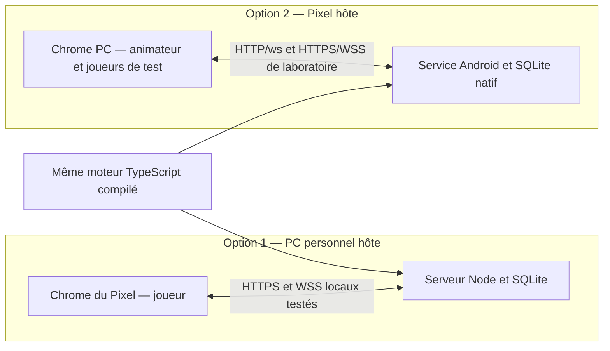
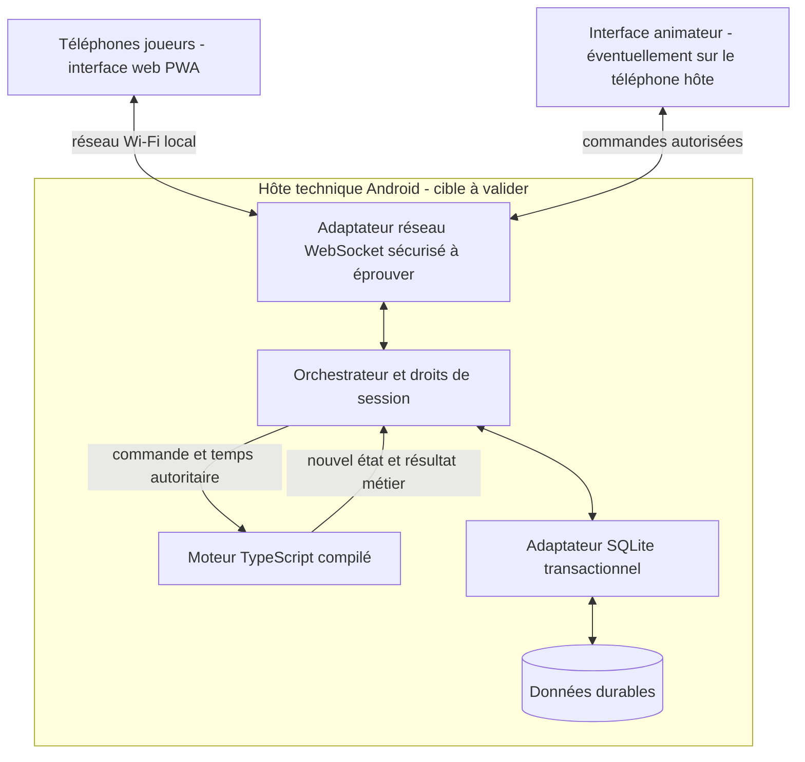
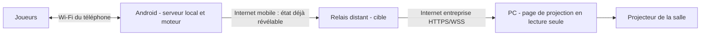
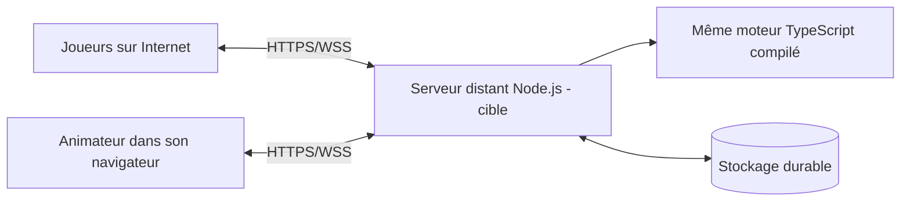
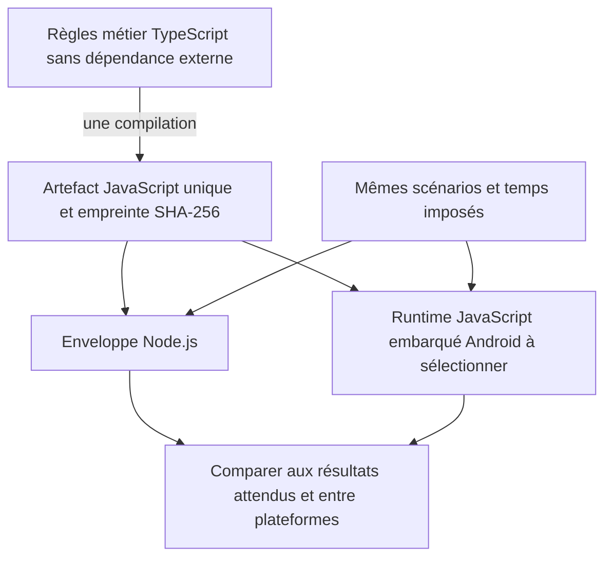

# Kuikuiz — Comprendre l'architecture actuelle et cible

**État de référence :** 22 novembre 2026, maquette de trois questions jouable sur Node et sur Pixel hôte. Ces schémas expliquent l'organisation ; les choix techniques encore ouverts sont détaillés dans [l'architecture](../ARCHITECTURE.md).

Les blocs marqués « cible » ne sont pas encore implémentés. Les schémas Mermaid peuvent être lus dans un aperçu Markdown compatible ; les paragraphes en donnent aussi la lecture.

## 1. Aujourd'hui : trois questions, deux possibilités d'hébergement

Les deux hôtes exécutent le même moteur : trois questions, réponse définitive, pause/reprise, correction, question suivante et classement cumulé. Chaque hôte possède son adaptateur réseau et son stockage SQLite ; aucune règle de score n'est réécrite en Java. Les interfaces web et le contrat des messages sont communs.

Le Pixel hôte a été utilisé sur le Wi-Fi habituel puis via son point d'accès. Une reprise après arrêt forcé conserve les réponses déjà confirmées et gèle la question courante. Le lien ADB sert à installer et vérifier l'application ; il ne transporte pas les commandes du jeu. Les joueurs n'en ont pas besoin.

Le mode Android HTTP/ws a fonctionné sans Internet sur le point d'accès ; [P16](../experiments/P16_MAQUETTE_TROIS_QUESTIONS.md) décrit cet essai. Le mode HTTPS/WSS a ensuite réussi sur le Wi-Fi habituel dans [P17](../experiments/P17_HTTPS_WSS_ANDROID.md), puis sur le point d'accès isolé dans [P20](../experiments/P20_WSS_POINT_ACCES_SANS_INTERNET.md) avec une nouvelle feuille de certificat couvrant les deux adresses. La clé serveur et l'autorité sont conservées. Chrome Pixel a préparé son interface, et l'utilisateur a terminé le quiz à 3 000 points avec la bonne adresse. Cette preuve de laboratoire ne valide pas encore un téléphone joueur distinct ni une confiance sans installation de certificat.

## 2. Cible locale : Android héberge la partie

Depuis [P18](../experiments/P18_CACHE_INTERFACE_PC.md), un service worker garde l'interface web et la configuration de connexion en cache. Les pages se rechargent lorsque le serveur est arrêté ; le jeu reste indisponible jusqu'au retour de l'hôte. Aucun score ni accusé de réception n'est fabriqué dans le cache. Cette preuve a été répétée automatiquement en HTTPS sur le Pixel dans [P19](../experiments/P19_RECETTE_CACHE_PIXEL.md), avec réponse retrouvée après reprise. L'utilisateur a aussi terminé le parcours tactile ; cela ne valide pas l'ergonomie finale.

Les joueurs communiquent avec l'hôte sur le réseau local : point d'accès Android ou routeur externe. Le téléphone calcule les résultats ; les connexions mobiles individuelles des joueurs ne sont pas nécessaires au traitement des réponses.

L'orchestrateur reçoit les commandes, contrôle les droits et demande au moteur d'appliquer les règles. Il sauvegarde le résultat, puis confirme au joueur **après la transaction réussie**. Une retransmission ne doit pas produire de points supplémentaires.

L'animateur pilote ; l'hôte exécute. Ces rôles peuvent être sur le même appareil ou sur deux appareils distincts. Héberger sur le téléphone d'un joueur ne lui donne aucun droit d'animation.

Le moteur embarqué et une reprise après arrêt forcé ont une première preuve sur Pixel. La connexion sécurisée depuis la PWA, les autres types de panne, l'endurance et le maintien prolongé en veille restent à éprouver.

## 3. Cible en salle : projection depuis un PC d'entreprise

Le PC reste sur le réseau d'entreprise. Il n'a pas besoin de joindre directement le téléphone : le relais reçoit les résultats autorisés et les transmet à la page de projection. Le téléphone reste l'autorité du jeu ; le relais ne corrige pas les réponses et ne calcule pas les scores.

Si Internet ou le relais tombe, la projection devient non actualisée et le signale ; la partie locale continue. Après reconnexion, l'écran récupère le dernier état autorisé. Les résultats encore masqués ne sont pas envoyés prématurément.

La page de projection ne pilote pas la partie. Aucun relais n'est déployé à ce stade. L'accès entreprise et le fonctionnement simultané point d'accès, serveur et connexion mobile sont encore à vérifier.

## 4. Cible Internet : le serveur Node.js héberge la partie

Ici, le serveur distant est l'hôte de la partie, et pas seulement un relais de projection. Son hébergement reste à choisir ; aucun déploiement n'est autorisé implicitement par ce schéma.

## 5. Pourquoi partager le moteur ?

Les règles de score, de pause et de réponse définitive sont écrites une seule fois. Les API réseau, stockage et Android restent dans des adaptateurs. Gradle fabriquera l'enveloppe Android ; il ne remplace pas le moteur TypeScript et ne prouve pas sa portabilité.

La preuve attendue utilise exactement les mêmes octets compilés sur les deux plateformes. Cette expérience reste à réaliser ; la sonde Java actuelle ne contient pas ce moteur.

## Repères

| Mot | Dans Kuikuiz |
|---|---|
| Hôte | Appareil qui exécute la partie et décide de l'acceptation des réponses. |
| Animateur | Personne autorisée à piloter la session. |
| PWA | Interface web préparée pour pouvoir démarrer hors ligne, sous réserve des essais. |
| WebSocket | Connexion permettant des messages dans les deux sens. `wss` ajoute TLS au transport. |
| Adaptateur | Couche reliant les règles communes à un environnement particulier. |
| Relais | Composant qui transmet l'état de projection entre les deux réseaux. |
| Gradle | Outil de construction Android sur le PC ; voir [l'explication](COMPRENDRE_GRADLE.md). |
